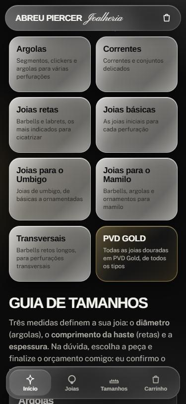
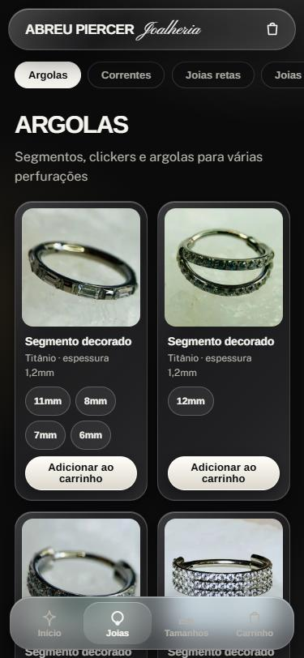

# 💎 Abreu Piercer · Catálogo de joias

Catálogo on-line de joias de piercing para a marca **Abreu Piercer**. A cliente escolhe as peças e os tamanhos, monta o carrinho e **finaliza o orçamento pelo WhatsApp**, com a mensagem já pronta. O site foi pensado para o celular e tem visual **Liquid Glass** (vidro fosco e acetinado), seguindo a identidade da marca.

🔗 **Site no ar:** https://abreu-piercer.onrender.com

---

## 📱 Telas

| Início | Tipos de joia | Catálogo |
|:---:|:---:|:---:|
|  |  |  |

---

## ✨ Funcionalidades

- **Catálogo por categorias** (argolas, correntes, joias retas, umbigo, transversais...) e uma seção **PVD Gold**, montada automaticamente para as joias douradas
- **Escolha de tamanho** em cada joia e **carrinho** que fica guardado no celular
- **Finalizar pelo WhatsApp**: a mensagem já sai com as joias, os tamanhos e o cupom em negrito
- **Guia de tamanhos** com explicação simples e pop-up de ajuda na primeira joia adicionada
- **Pesquisa de satisfação em estrelas** que gera um **cupom de 5%**
- **Carrossel "Inspire-se"** com trabalhos realizados
- **Catálogo atualizado por uma planilha Google**: dá para lançar joias novas sem mexer no código
- **Navegação inferior fixa**, transições suaves e imagens leves para carregar rápido

## 🔐 Segurança

- Senhas e chaves apenas em **variáveis de ambiente** no servidor
- Área restrita com **senha, limite de tentativas, proteção CSRF e login com validade**
- **Política de segurança de conteúdo (CSP)** e outros cabeçalhos de proteção
- Dados de clientes e informações comerciais **nunca** vão para o repositório

## 🛠️ Tecnologias

| Parte | O que usei |
|---|---|
| Front-end | HTML5, CSS3 (Liquid Glass, responsivo, *mobile first*), JavaScript puro |
| Back-end | Python 3, Flask, Jinja2 |
| Dados | Google Planilhas (catálogo) + Google Apps Script |
| Integração | Link do WhatsApp com mensagem pronta |
| Hospedagem | Render (com Gunicorn) |
| Ferramentas | VS Code, Git, GitHub e GitHub Desktop |

---

## 📂 O que tem neste repositório

Este é um **repositório-vitrine**: ele mostra a parte visual do catálogo (o que roda no navegador).

```
templates/   páginas HTML (Jinja2): início, categorias, cartão da joia, guia de tamanhos e carrinho
static/      style.css (todo o visual) e app.js (carrinho, pop-ups, pesquisa, cupom e WhatsApp)
prints/      capturas de tela do site
```

O **back-end** (servidor em Flask, planilha, cupons e área restrita) é **privado**, por segurança. As fotos das joias também ficam de fora. Por isso o projeto não roda só com estes arquivos. Para ver funcionando, acesse o [site no ar](https://abreu-piercer.onrender.com).

## 💡 O que aprendi

- Criar um visual "vidro fosco" (Liquid Glass) que fica bonito e continua leve no celular
- Organizar o CSS para que uma regra não "vaze" e estrague outra parte do site
- Usar uma planilha como "painel" simples para o dono do negócio atualizar o catálogo
- Montar um carrinho que funciona só no navegador e vira uma mensagem de WhatsApp
- Proteger uma área restrita (senha, CSRF, limite de tentativas)

---

👤 Desenvolvido por **Airan Abreu Tavares** · [@abreuairan](https://github.com/abreuairan)

© Todos os direitos reservados: o código pode ser visto para avaliação, mas não pode ser copiado ou reutilizado sem permissão.
